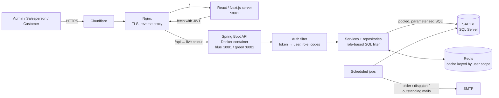
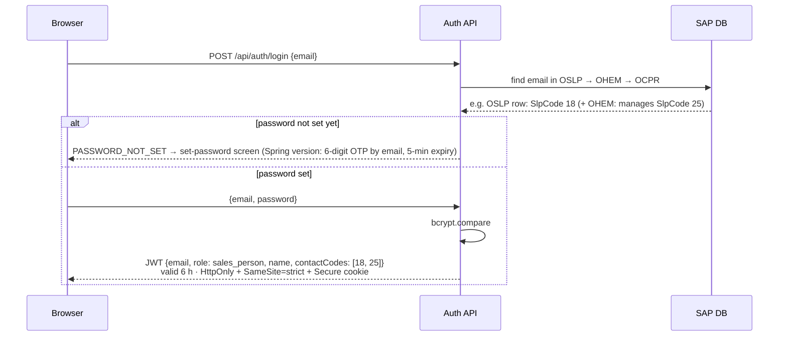
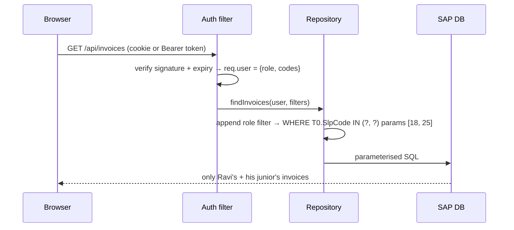
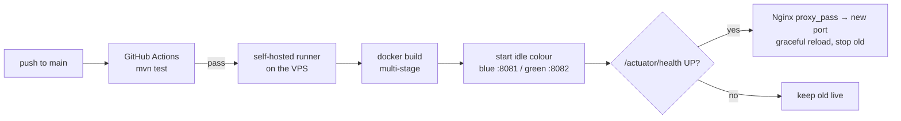

# Sales Dashboard Platform

> Internal and customer-facing sales dashboards on top of **SAP Business One**, built with **Spring Boot and React / Next.js**. **JWT authentication with role-based, row-level access** means Admins, Salespeople and Customers each see only their own data. It serves **200+ users** in production and is deployed with **Docker + Nginx**.

**Stack:** Java 17 · Spring Boot 3 · Spring Security · JWT · JdbcTemplate · React / Next.js · SQL Server (SAP B1) · Redis · ApexCharts / Chart.js · TanStack Table · Excel / PDF export · Docker (multi-stage) · Nginx · GitHub Actions

> **Note:** this system runs in production at my employer. The code is proprietary, so this repo documents the architecture, access-control design and trade-offs only. It contains no company code, data, credentials or customer names.

---

## The 30-second pitch

> "All our sales data lives in SAP, but only a few people had SAP licences. Salespeople phoned the office for a customer's balance or dispatch status, customers emailed for invoices and COAs, and management got numbers from manual Excel reports. I built one dashboard that reads SAP directly. **At login, I resolve who you are in SAP** (your salesperson code, or your customer contact code) and put that into the JWT. **Every SQL query is then filtered by those codes**, so each user only ever sees their own rows. The frontend is React / Next.js, the backend is moving from Next.js API routes to Spring Boot, and it runs in Docker behind Nginx for 200+ users."

---

## Architecture



---

## How login, roles and the JWT work (the core of the project)

### Where the role comes from: SAP's own tables

| SAP table | What it holds | Becomes |
|---|---|---|
| **OSLP** | Sales employees → **`SlpCode`** | role **Salesperson**, scope = their `SlpCode` |
| **OHEM** | Employee master (incl. which sales employee a person manages) | **hierarchy**: a manager also gets their juniors' `SlpCode`s |
| **OCPR** | Customer contact persons → **`CntctCode`** (+ the customer's `CardCode`) | role **Customer**, scope = their contact / customer code |
| app users table | Admin accounts | role **Admin**, no row filter |

### Login flow



**What's inside the JWT** (header.payload.signature, base64url):

```json
{ "email": "ravi@company.com", "role": "sales_person", "name": "Ravi",
  "contactCodes": ["18", "25"], "iat": 1762500000, "exp": 1762521600 }
```

- The **signature** (HMAC with a server secret) means the browser can **read** the payload but **cannot change** it. If someone edits `contactCodes` to `["99"]`, the signature check fails → `401`.
- It's stored in an **HttpOnly** cookie (JavaScript can't read it → safer against XSS) with **SameSite=strict** (not sent on cross-site requests → CSRF protection).
- **Stateless:** the server doesn't store sessions; any instance can verify the token with the secret.

### Every request: token → codes → filtered SQL



```java
private void applyRoleBasedFilter(StringBuilder sql, List<Object> params, User user) {
    Long role = user.getRoleId();
    if (role == null) { sql.append(" AND 1=0 "); return; }              // unknown → nothing
    if (role == ADMIN) return;                                           // admin   → all rows
    if (role == SALESPERSON) { sql.append(" AND T0.SlpCode IN (?) ");   params.add(user.getCodes()); }
    else if (role == CUSTOMER) { sql.append(" AND T0.CntctCode = ? ");  params.add(user.getCode()); }
    else sql.append(" AND 1=0 ");                                        // deny by default
}
```

| Role | Sees | Filter |
|---|---|---|
| **Admin** | Everything | none |
| **Salesperson** | Their customers' orders, invoices, outstanding (+ juniors') | `SlpCode IN (own, juniors…)` |
| **Customer** | Only their own orders, invoices, documents | `CntctCode = ?` / `CardCode = ?` |

**Rules that make it safe:**
- **Deny by default:** `AND 1=0` for an unknown role or missing code. A bug means *no data*, never *all data*.
- **Codes come from the token, never from the request.** A salesperson sending `?slpCode=42` is ignored, which prevents **IDOR** (changing an id in the URL).
- **Parameterised SQL** (`?` placeholders): no string concatenation of user input → no SQL injection.
- **The same filter is applied to Excel/PDF exports and scheduled emails**, which is where data usually leaks.
- **The Redis cache key includes the scope:** `daily-chart:{user}:{month}:{slpCodes}:{cardCodes}`. If the key held only the filters, a salesperson could get the admin's cached company-wide numbers.

### JWT vs the opaque token in the Spring Boot version

The Spring Boot backend uses an **opaque session token** (a UUID in a `refresh_tokens` table) instead of a JWT. Knowing why is a strong interview answer:

| | JWT (Next.js version) | Opaque DB token (Spring version) |
|---|---|---|
| Validation | Signature check, **no DB hit** | DB lookup on every request |
| Logout / revoke | Hard: valid until expiry unless you keep a blocklist | **Instant**: set `revoked = 1` |
| Role change | Old role stays in the token until re-login | Read fresh from the DB |
| Scaling | Any instance verifies with the secret | Needs a shared DB / Redis |

For a few hundred users, a DB lookup is cheap and **instant revocation** matters more, so the new backend uses opaque tokens. For many services or very high traffic, JWT's no-lookup verification wins. A common middle ground is a **short-lived JWT plus a revocable refresh token**.

---

## Deployment: Docker + Nginx



**The Docker image (multi-stage):**
```dockerfile
FROM maven:3.9.9-eclipse-temurin-21 AS build      # stage 1: build
WORKDIR /app
COPY backend/pom.xml .
RUN mvn -q -B dependency:go-offline                # dependencies = cached layer
COPY backend/. .
RUN mvn -q -B clean package -DskipTests

FROM eclipse-temurin:21-jre                        # stage 2: run (small, no Maven/source)
WORKDIR /app
COPY --from=build /app/target/*.jar app.jar
EXPOSE 8080
ENTRYPOINT ["java", "-Xms512m", "-Xmx1536m", "-jar", "app.jar"]
```

- **Why multi-stage:** the final image has only the JRE + JAR, so it's smaller, faster to start and has less attack surface. Copying `pom.xml` before the source means dependencies are re-downloaded only when the pom changes.
- **docker-compose profiles** (`blue`, `green`) define the two containers with the same image and different `SERVER_PORT`.
- **Nginx** terminates TLS, serves `/` from the React / Next.js server on `:3001`, and proxies `/api` to whichever colour is live. Switching is `nginx -t && nginx -s reload`, which is graceful, so in-flight requests finish.
- **Secrets** (DB, JWT secret, SMTP) come from environment variables on the server, never from the image or the repo.

---

## Components

| Component | What it does |
|---|---|
| **Auth** | SAP-based identity lookup, BCrypt passwords, JWT (Next.js) / opaque token + OTP (Spring), HttpOnly cookie or Bearer header |
| **KPI home** | Today / week / month sales, lines and orders compared with the **same number of days** in the previous period |
| **Dashboards** | Customer, salesperson and admin views; target vs achievement; sales vs COGS margins |
| **Orders and invoices** | Orders with line items, invoices with print / PDF, outstanding + aging, top outstanding customers |
| **Dispatch** | Pending dispatch and courier waybill tracking |
| **Documents** | COA / MSDS / spec download by item code + batch, with an exists-check first |
| **Exports** | Excel and PDF, using the same row-level filter |
| **Notifications** | Scheduled order-confirmation, dispatch, outstanding and target emails |
| **Caching** | Redis cache-aside (30–60 min) for heavy charts, with the scope in the key |

---

## Testing

- **Role filter tests (Mockito):** admin = no filter; salesperson = `SlpCode IN`; customer = `CntctCode`; unknown role = `1=0`.
- **Security tests (MockMvc):** `401` without or with a tampered token; `403` on admin endpoints for other roles; **IDOR test**: a salesperson passing another `slpCode` still gets only their own rows.
- **Number checks:** KPI totals compared with the same query run directly in SAP for a known period.
- Tests run in GitHub Actions before the Docker deploy; a failing test stops the deploy.

---

## Interview questions on this project

**Q: How does a salesperson only see their own data?**
At login I find their email in SAP's OSLP table and get their `SlpCode` (plus juniors' codes via OHEM). That goes into the signed JWT. On every request the filter verifies the token and the repository appends `WHERE SlpCode IN (...)` with those codes as parameters. Codes never come from the request, and an unknown role gets `1=0`.

**Q: What if a user edits their JWT?**
The signature no longer matches the payload, so verification fails → `401`. They can *read* the token (it's only base64), so I never put secrets in it, only ids and the role.

**Q: How do you log someone out with JWT?**
Clear the cookie. But a stolen token stays valid until expiry, so: a short expiry (6 h here), a blocklist of revoked token ids in Redis, or, as in the Spring version, opaque tokens that can be revoked instantly.

**Q: How would you scale it?**
The API is stateless, so add containers behind an Nginx `upstream` with shared Redis. The real pressure is **report queries on SAP**: move them to a **read replica**, add **pre-aggregated daily summary tables**, and generate big exports **asynchronously** (queue a job, email a link). Move scheduled emails to RabbitMQ with retries and a sent-log, so nobody is mailed twice.

**Q: Biggest problem you faced?**
**Inflated sales totals.** Joining invoice headers to lines and summing the *header* amount multiplied it by the number of lines. **Fix:** sum `LineTotal` for item metrics, `DocTotal` from the header table alone, and subtract credit notes for net sales.

**Q: Other challenges?**
- **Unfair period comparison:** on the 10th, "this month vs last month" compared 10 days with 30. **Fix:** compare the 1st–10th with the 1st–10th.
- **Connection pool dying** ("Connection is closed") after network blips. **Fix:** min 2 / max 10 pool, a longer idle timeout, rebuild the pool on error.
- **Caching without leaking data:** the scope is in every cache key.

**Q: What would you improve?**
An audit log of who viewed or exported what; refresh-token rotation; a reporting replica; async exports; integration tests against a SQL Server container (Testcontainers).
