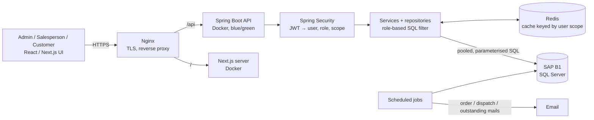

# Sales Dashboard Platform

> Internal and customer-facing sales dashboards on top of **SAP Business One**, built with **Spring Boot and React / Next.js**. **JWT authentication with role-based, row-level access** for Admins, Salespeople and Customers serves **200+ users** in production, deployed with **Docker + Nginx**.

**Stack:** Java 17 · Spring Boot 3 · Spring Security · JWT · JdbcTemplate · React / Next.js · SQL Server (SAP B1) · Redis · ApexCharts / Chart.js · TanStack Table · Excel / PDF export · Docker · Nginx · GitHub Actions

> **Note:** this system runs in production at my employer. The code is proprietary, so this repo documents the architecture, access-control design and trade-offs only. It contains no company code, data, credentials or customer names.

---

## The 30-second pitch

> "All our sales data lives in SAP, but only a few people had SAP licences. Salespeople phoned the office for a customer's balance or dispatch status, customers emailed for invoices and COAs, and management got numbers from manual Excel reports. I built one dashboard that reads SAP directly and shows **each user only the rows they're allowed to see**: KPIs, orders, invoices, outstanding and aging, dispatch tracking, documents, targets and margins, with Excel and PDF exports. The frontend is React / Next.js. The backend started as Next.js API routes and I moved it to **Spring Boot**, with the same role-based filtering. 200+ salespeople, admins and customers use it."

---

## Architecture



### Request flow: `GET /api/invoices?from=2026-10-01`

1. Nginx terminates TLS and routes `/api` to the live Spring Boot container.
2. The security filter validates the **JWT** (signature + expiry) and loads the user: **role** + **scope** (salesperson code or customer contact code).
3. The service builds parameterised SQL and appends the **row-level filter** for that role (below).
4. Expensive aggregates are served from Redis using a cache key that **includes the user's scope**.
5. The same filter is applied to **exports and scheduled emails**, which is where data usually leaks.

---

## Row-level security: the core design

```java
private void applyRoleBasedFilter(StringBuilder sql, List<Object> params, User user) {
    Long role = user.getRoleId();
    if (role == null) { sql.append(" AND 1=0 "); return; }            // unknown → nothing
    if (role == ADMIN) return;                                         // admin   → all rows
    if (role == SALESPERSON) { sql.append(" AND T0.SlpCode = ? ");   params.add(user.getCode()); }
    else if (role == CUSTOMER) { sql.append(" AND T0.CntctCode = ? "); params.add(user.getCode()); }
    else sql.append(" AND 1=0 ");                                      // deny by default
}
```

| Role | Sees | Can do |
|---|---|---|
| **Admin** | Everything | All dashboards, all reports, exports |
| **Salesperson** | Only their own customers' orders, invoices and outstanding (plus juniors', via the hierarchy) | KPIs, targets vs achievement, dispatch status, exports |
| **Customer** | Only their own orders and invoices | Track orders, download invoices, COA / MSDS documents |

- **Deny by default:** a bug means *no data*, never *all data*.
- **Scope comes from the server-side identity** (token → DB), never from a request parameter, which prevents **IDOR** (changing an id in the URL).
- **Sales hierarchy:** at login, a manager's scope is enriched with their juniors' salesperson codes, and every query uses `SlpCode IN (...)` with no special cases further down.

---

## Components

| Component | What it does |
|---|---|
| **Auth** | Login → JWT (role + scope claims) in an HttpOnly cookie or Bearer header; BCrypt passwords; refresh tokens on the Spring Boot side |
| **KPI home** | Today / week / month sales, lines and orders compared with the *same number of days* in the previous period |
| **Dashboards** | Customer, salesperson and admin views; target vs achievement; sales vs COGS margins |
| **Orders and invoices** | Orders with line items, invoices with print / PDF, outstanding + aging, top outstanding customers |
| **Dispatch** | Pending dispatch and courier waybill tracking |
| **Documents** | COA / MSDS / spec download by item code + batch, with an exists-check first |
| **Exports** | Excel and PDF, using the same row-level filter |
| **Notifications** | Scheduled order-confirmation, dispatch, outstanding and target emails |
| **Caching** | Redis cache-aside (30–60 min) for heavy chart and aggregate queries |

---

## Design decisions and trade-offs

| Decision | Why | Trade-off |
|---|---|---|
| **One app, three roles** | One codebase and one deployment instead of three dashboards | Every query must be scoped, so it's centralised in one filter |
| **Stateless JWT** | No server sessions; any instance can serve any user | Revoking before expiry needs short expiry + refresh tokens |
| **Read SAP directly (read-only)** | Always live numbers, no sync to maintain | Reports put load on the SAP DB → caching, and a reporting replica later |
| **Raw SQL (JdbcTemplate)** | SAP's schema isn't ours to map as JPA entities; reports are aggregations | More SQL to test by hand |
| **Cache key includes the scope** | A shared cache is a data-leak risk in a role-based app | Lower hit rate than a global cache |
| **Next.js → Spring Boot migration** | Typed, testable, transactions, same stack as our other APIs | Running both during the migration; parity checks per module |

---

## Testing

- **Service tests (Mockito):** the role filter for each role (admin = no filter, salesperson = `SlpCode`, customer = `CntctCode`, unknown = `1=0`).
- **Controller tests (MockMvc):** 401 without a token, 403 for a wrong role, and the response shape.
- **Security cases:** a salesperson passing another salesperson's id still gets only their own rows (**IDOR test**).
- **Number checks:** KPI totals compared with the same query run in SAP for a known period.

---

## Interview questions on this project

**Q: How would you scale it?**
The API is stateless (JWT), so I'd run more containers behind Nginx and share Redis. The real pressure is **report queries on the SAP database**, so I'd move them to a **read replica** or reporting server, add **pre-aggregated daily summary tables** refreshed by a job, and generate big Excel exports **asynchronously** (queue a job, email a link) instead of inside the request. Scheduled emails would move from cron to a queue (RabbitMQ) with retries and a sent-log, so nobody is mailed twice.

**Q: What was the biggest problem you faced?**
**Inflated sales totals.** Joining invoice headers to invoice lines and then summing the *header* amount multiplied it by the number of lines. **Fix:** sum `LineTotal` for item-level metrics, sum `DocTotal` from the header table alone, and subtract credit notes for net sales.

**Q: Other challenges?**
- **Unfair period comparison:** on the 10th, "this month vs last month" compared 10 days with 30 and always showed a drop. **Fix:** compare the 1st–10th with the 1st–10th of the previous month.
- **Connection pool dying** ("Connection is closed") after network blips. **Fix:** a pool of min 2 / max 10, a longer idle timeout, and rebuilding the pool on error.
- **Caching without leaking data:** every cache key includes the user's full scope, so two users share an entry only if their scopes are identical.

**Q: How do you stop a salesperson seeing another salesperson's data?**
Two layers. The **role** check decides which endpoints you can call (`@PreAuthorize`). The **ownership** check decides which rows you get: the scope comes from the verified token and the DB, never the request, and the SQL filter denies by default. The same filter applies to exports and emails.

**Q: JWT vs sessions here?**
JWT keeps the API stateless and works for both internal and customer users. The cost is revocation, handled with a short expiry plus refresh tokens stored server-side, which can be revoked.

**Q: What would you improve?**
An audit log of who viewed or exported what; refresh-token rotation; a reporting replica; async exports; and integration tests against a SQL Server container (Testcontainers).
