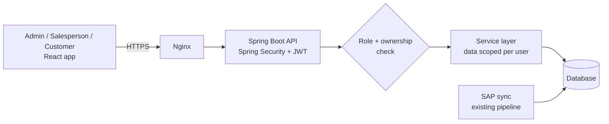

# Sales Dashboard Platform — Architecture Case Study

> Internal and customer-facing sales dashboards built with Spring Boot and React, secured with JWT and **role-based access control for Admins, Salespeople and Customers**, serving **200+ users** in production.

**Note:** This system runs in production at my current employer. The source code is proprietary, so this repository documents the **architecture, access-control design and trade-offs** only. No company code, data, credentials or customer names are included.

<!-- Replace every [bracketed] value with a real figure. Remove any line describing something you have not implemented. -->

---

## The problem

Sales data was spread across [ERP exports / spreadsheets / email]. Different people needed different views of it:

- **Admins** needed the full picture: all salespeople, all customers, all orders.
- **Salespeople** needed their own customers, orders and targets, and nothing else.
- **Customers** needed a self-service view of their own orders and documents, instead of emailing sales.

One system had to serve all three without any user ever seeing data that isn't theirs.

## Architecture

1. A user logs in and receives a JWT carrying their user id and role.
2. Every request passes through Spring Security, which validates the token.
3. Endpoint access is checked by **role**; data access is checked by **ownership**.
4. Queries are scoped in the service layer, so a salesperson's query only ever returns their own customers.

## Access-control design

| Role | Can see | Can do |
|---|---|---|
| **Admin** | All salespeople, customers, orders, reports | [Manage users, assign customers to salespeople, …] |
| **Salesperson** | Only their assigned customers and orders | [View targets, track orders, …] |
| **Customer** | Only their own orders and documents | [Track orders, download COAs/invoices, …] |

**Two layers of checks, not one.**

- **Role check (what you can call):** `@PreAuthorize("hasRole('ADMIN')")` on admin-only endpoints.
- **Ownership check (whose data you get):** the user id comes from the verified JWT, never from a request parameter. A salesperson calling `/orders?salespersonId=42` still only receives their own orders.

The second layer prevents the most common access-control bug in dashboards: changing an id in the URL to see someone else's data (IDOR).

## Key design decisions

| Decision | Why | Trade-off |
|---|---|---|
| **One app, three roles** | One codebase and deployment instead of three separate dashboards | Every query must be carefully scoped by role |
| **Stateless JWT auth** | No server-side sessions; scales horizontally; works for internal and external users | Revoking a token before expiry needs extra handling ([short expiry / refresh tokens / denylist]) |
| **Scoping in the service layer** | Ownership rules live in one place, not repeated in each controller | Service methods need the current user passed in or resolved |
| **React SPA + REST API** | Clean separation; the same API can later serve a mobile app | Two deployables to manage |

## Results

| Metric | Value |
|---|---|
| Active users | 200+ across Admin, Salesperson and Customer roles |
| [Manual sales reports / customer status emails] replaced | [X per week] |
| Dashboard load time | [X] s |
| Access-control incidents | [0] |

## Tech stack

Java · Spring Boot · Spring Security · JWT · Spring Data JPA / Hibernate · React.js · [MySQL / SQL Server] · Nginx · Docker · GitHub Actions

## What I would improve next

- Refresh tokens with rotation, for safer long sessions.
- Audit log of who viewed or changed what, for admin accountability.
- [Your own honest answer]
